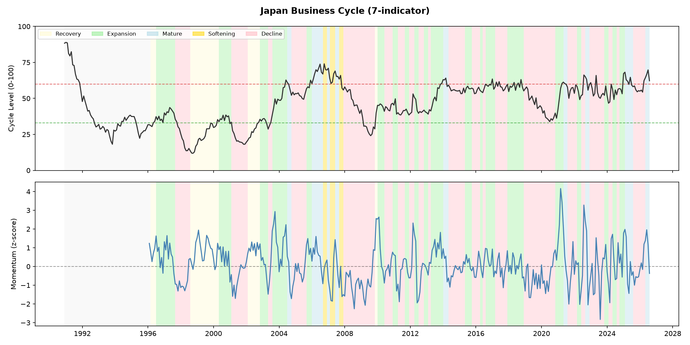
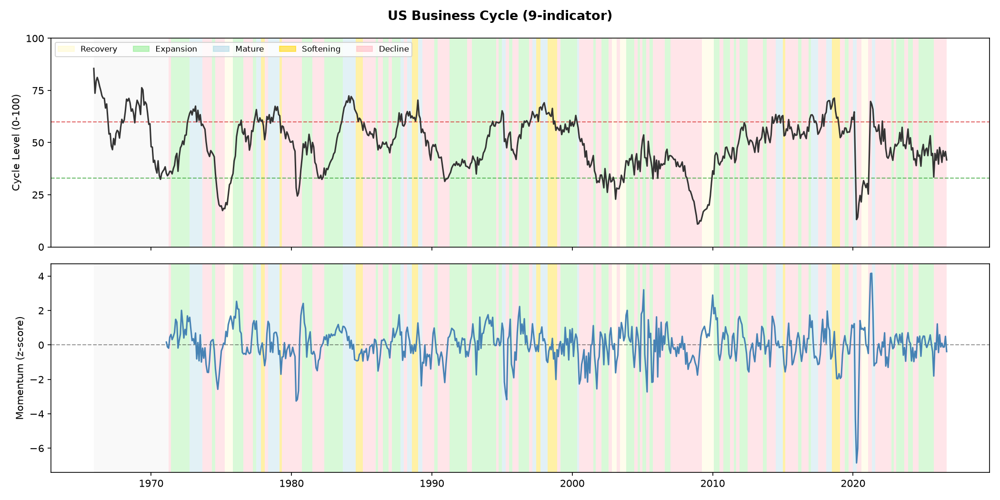
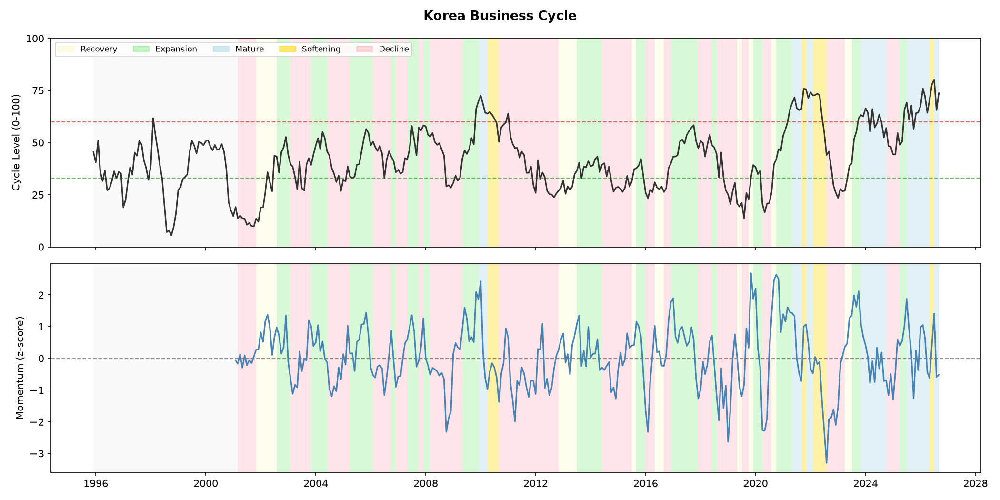
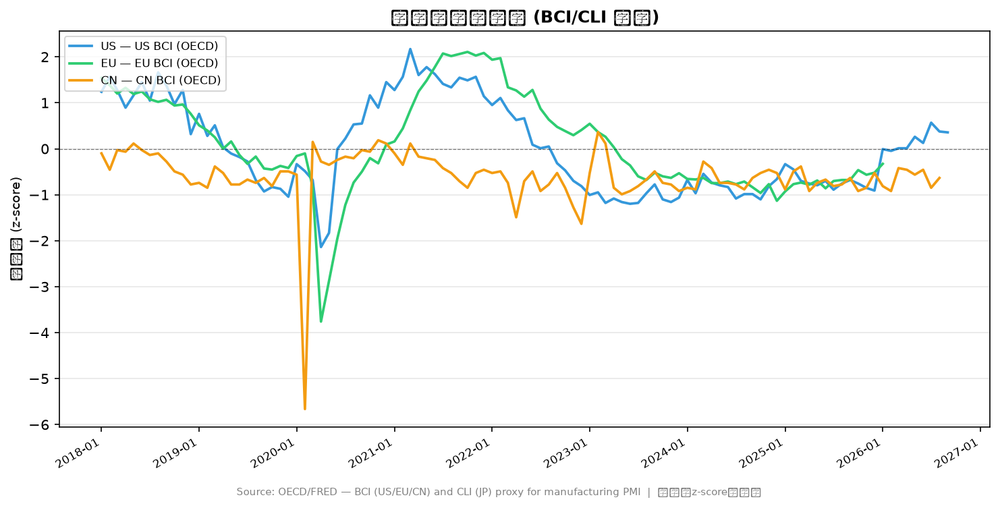
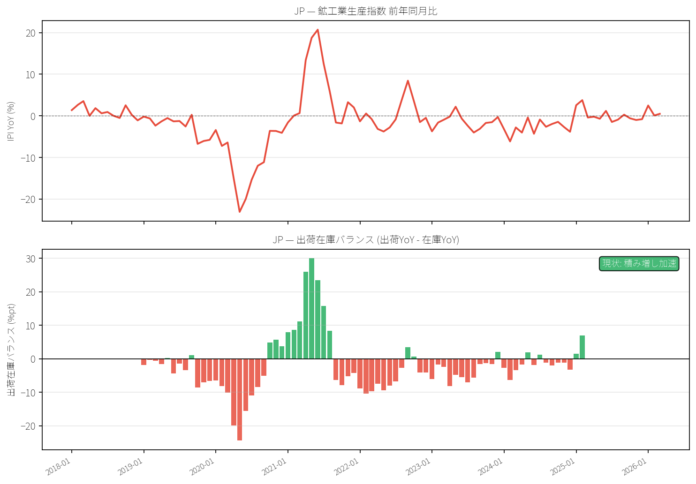
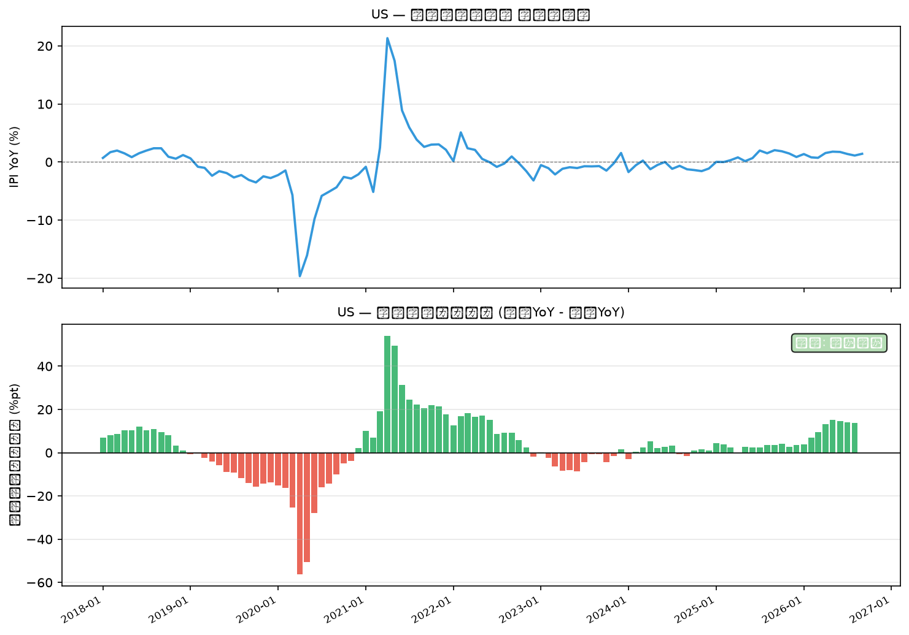
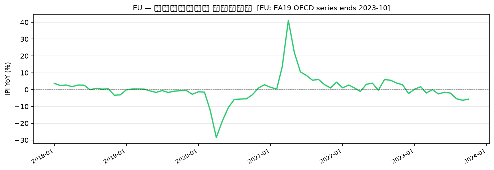
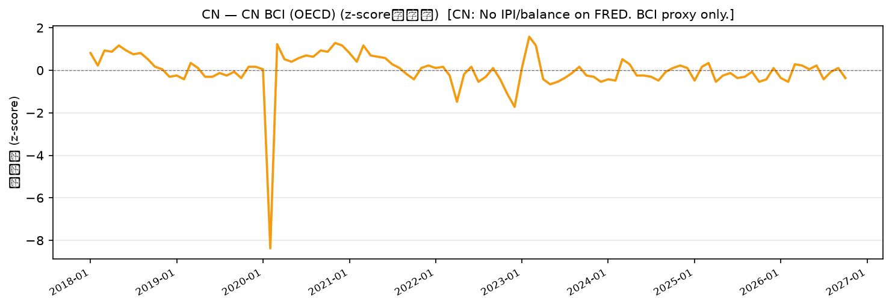

# Business Cycle Report: 2026-10

*生成: 2026-10-25 13:34 UTC*

## サマリー

| 国 | ステージ | Level | Momentum | 前月比 |
|---|---|---|---|---|
| JP | 成熟 | 62.3 | -0.37 | ↓ |
| US | 下降 | 41.7 | -0.38 | ↓ |
| KR | 軟化 | 73.6 | -0.52 | ↑ |

**CN Signal:** BCI -0.40 (Contracting) [2026-08]  
*(OECD Mfg Business Confidence — NBS/Caixin PMI is not available on FRED/OECD)*

## ステージ推移（直近6ヶ月）

### JP

| 月 | Level | Momentum | Stage |
|---|---|---|---|
| 2026-03 | 54.4 | -0.16 | 下降 |
| 2026-04 | 62.3 | +1.19 | 下降 |
| 2026-05 | 64.3 | +1.38 | 成熟 |
| 2026-06 | 66.7 | +1.96 | 成熟 |
| 2026-07 | 69.8 | +1.16 | 成熟 |
| 2026-08 | 62.3 | -0.37 | 成熟 |

### US

| 月 | Level | Momentum | Stage |
|---|---|---|---|
| 2026-04 | 45.0 | -0.12 | 下降 |
| 2026-05 | 40.5 | +0.10 | 下降 |
| 2026-06 | 46.1 | -0.13 | 下降 |
| 2026-07 | 43.4 | -0.12 | 下降 |
| 2026-08 | 45.8 | +0.50 | 下降 |
| 2026-09 | 41.7 | -0.38 | 下降 |

### KR

| 月 | Level | Momentum | Stage |
|---|---|---|---|
| 2026-04 | 64.3 | -0.43 | 成熟 |
| 2026-05 | 70.6 | -0.62 | 軟化 |
| 2026-06 | 77.9 | +0.45 | 軟化 |
| 2026-07 | 80.2 | +1.42 | 成熟 |
| 2026-08 | 65.6 | -0.59 | 成熟 |
| 2026-09 | 73.6 | -0.52 | 軟化 |

## チャート

## データカバレッジ

- **JP**: 1990-12 ~ 2026-08 (429 obs)
- **US**: 1965-12 ~ 2026-09 (730 obs)
- **KR**: 1995-12 ~ 2026-09 (370 obs)

## 在庫循環分析

*データ生成: 2026-10-25*

### AI解釈

USの在庫循環は積み増しフェーズ（回復スコア最上位: 電気機械 98pt）。

### フェーズ判定

| 国 | フェーズ | 前回判定 | 変化 |
|---|---|---|---|
| JP | 取得失敗 | — | — |
| US | 積み増し | 積み増し | 変化なし |
| EU | データなし | データなし | 変化なし |
| CN | データなし | データなし | 変化なし |

★ = 前回判定から変化あり

### 業種別回復スコア

### US — 回復スコア

**上位3業種 (最も回復)**

| 業種 | スコア |
|---|---|
| 電気機械 | 97.8pt |
| 一般機械 | 94.9pt |
| コンピューター・電子機器 | 93.3pt |

**下位3業種 (最も低迷)**

| 業種 | スコア |
|---|---|
| 輸送機械 | 35.2pt |
| 一次金属 | 41.5pt |
| 石油化学・化学 | 43.6pt |

### チャート

