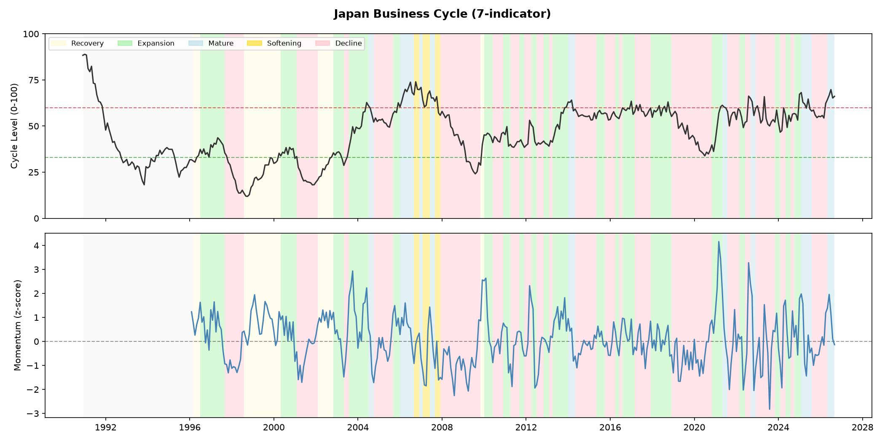
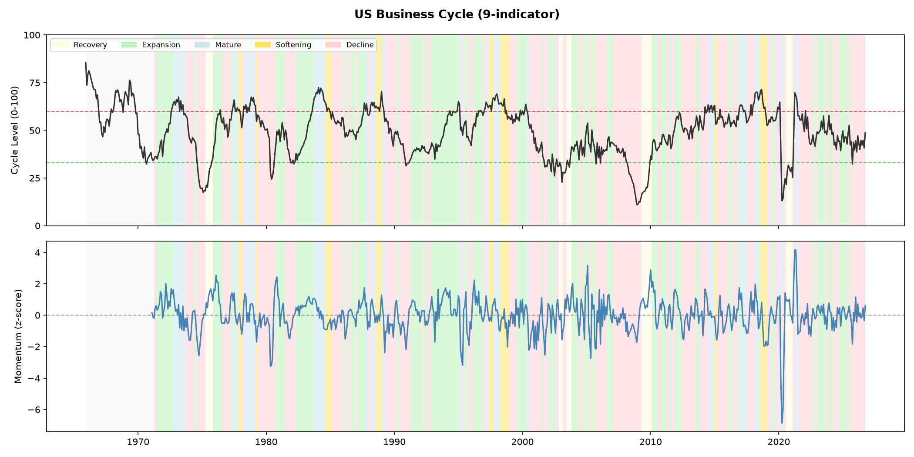
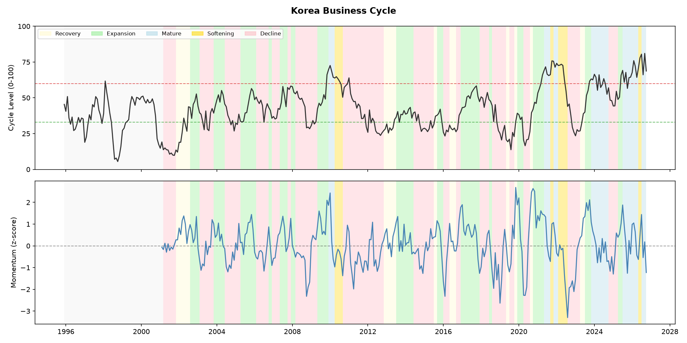
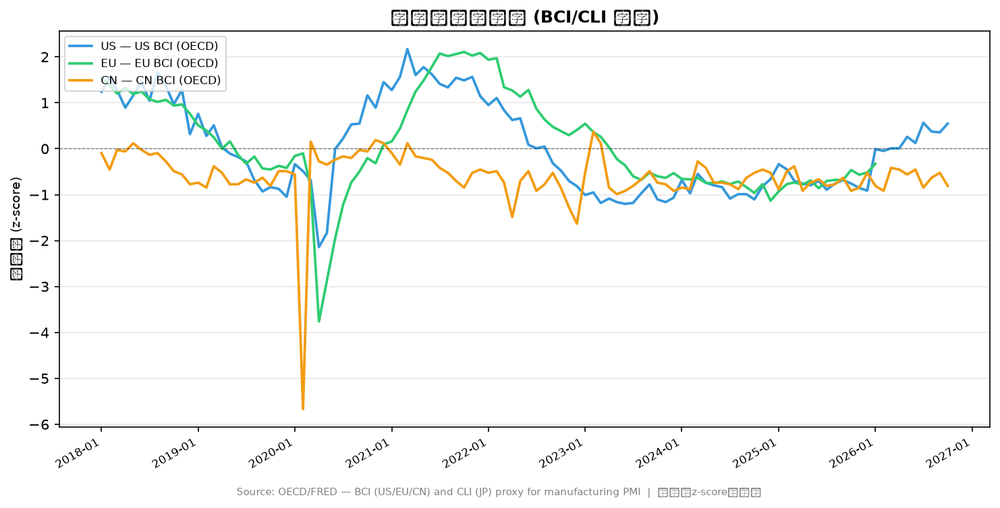
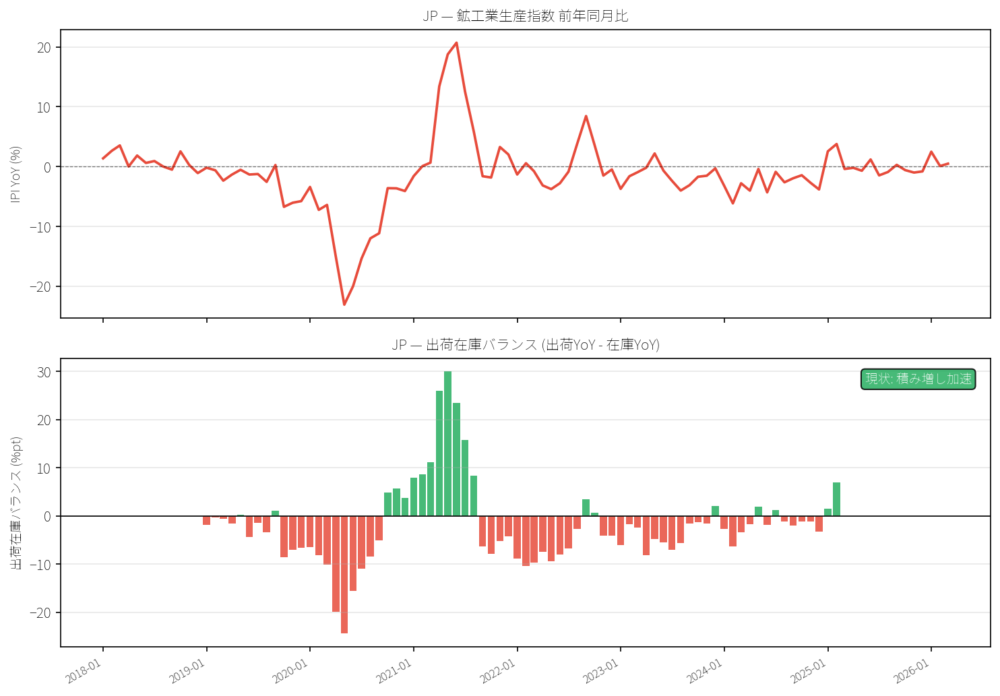
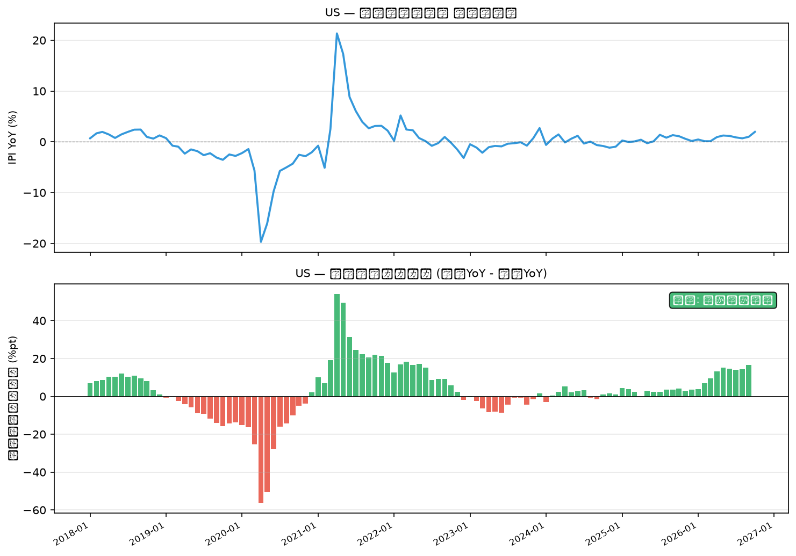
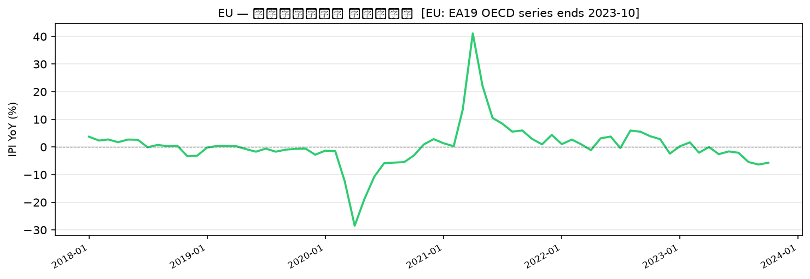
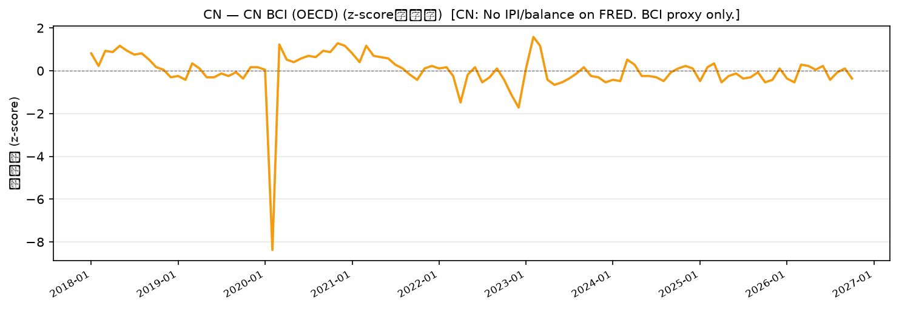

# Business Cycle Report: 2026-11

*生成: 2026-11-25 18:59 UTC*

## サマリー

| 国 | ステージ | Level | Momentum | 前月比 |
|---|---|---|---|---|
| JP | 成熟 | 66.1 | -0.14 | ↑ |
| US | 下降 | 48.7 | +0.61 | ↑ |
| KR | 成熟 | 68.7 | -1.23 | ↓ |

**CN Signal:** BCI -1.40 (Contracting) [2026-10]  
*(OECD Mfg Business Confidence — NBS/Caixin PMI is not available on FRED/OECD)*

## ステージ推移（直近6ヶ月）

### JP

| 月 | Level | Momentum | Stage |
|---|---|---|---|
| 2026-04 | 62.3 | +1.19 | 下降 |
| 2026-05 | 64.3 | +1.38 | 成熟 |
| 2026-06 | 66.7 | +1.96 | 成熟 |
| 2026-07 | 69.8 | +1.16 | 成熟 |
| 2026-08 | 65.2 | +0.10 | 成熟 |
| 2026-09 | 66.1 | -0.14 | 成熟 |

### US

| 月 | Level | Momentum | Stage |
|---|---|---|---|
| 2026-05 | 40.0 | +0.15 | 下降 |
| 2026-06 | 44.8 | -0.19 | 下降 |
| 2026-07 | 42.3 | -0.08 | 下降 |
| 2026-08 | 44.8 | +0.46 | 下降 |
| 2026-09 | 40.7 | -0.34 | 下降 |
| 2026-10 | 48.7 | +0.61 | 下降 |

### KR

| 月 | Level | Momentum | Stage |
|---|---|---|---|
| 2026-05 | 70.6 | -0.62 | 軟化 |
| 2026-06 | 77.9 | +0.45 | 軟化 |
| 2026-07 | 80.5 | +1.44 | 成熟 |
| 2026-08 | 66.1 | -0.54 | 成熟 |
| 2026-09 | 81.0 | +0.18 | 成熟 |
| 2026-10 | 68.7 | -1.23 | 成熟 |

## チャート

## データカバレッジ

- **JP**: 1990-12 ~ 2026-09 (430 obs)
- **US**: 1965-12 ~ 2026-10 (731 obs)
- **KR**: 1995-12 ~ 2026-10 (371 obs)

## 在庫循環分析

*データ生成: 2026-11-25*

### AI解釈

USの在庫循環は積み増し加速フェーズ（回復スコア最上位: プラスチック・ゴム 100pt）。

### フェーズ判定

| 国 | フェーズ | 前回判定 | 変化 |
|---|---|---|---|
| JP | 取得失敗 | — | — |
| US | 積み増し加速★ | 積み増し | 変化あり |
| EU | データなし | データなし | 変化なし |
| CN | データなし | データなし | 変化なし |

★ = 前回判定から変化あり

### 業種別回復スコア

### US — 回復スコア

**上位3業種 (最も回復)**

| 業種 | スコア |
|---|---|
| プラスチック・ゴム | 100.0pt |
| 一般機械 | 94.1pt |
| コンピューター・電子機器 | 75.8pt |

**下位3業種 (最も低迷)**

| 業種 | スコア |
|---|---|
| 電気機械 | 32.9pt |
| 紙製品 | 37.3pt |
| 石油化学・化学 | 39.8pt |

### チャート

